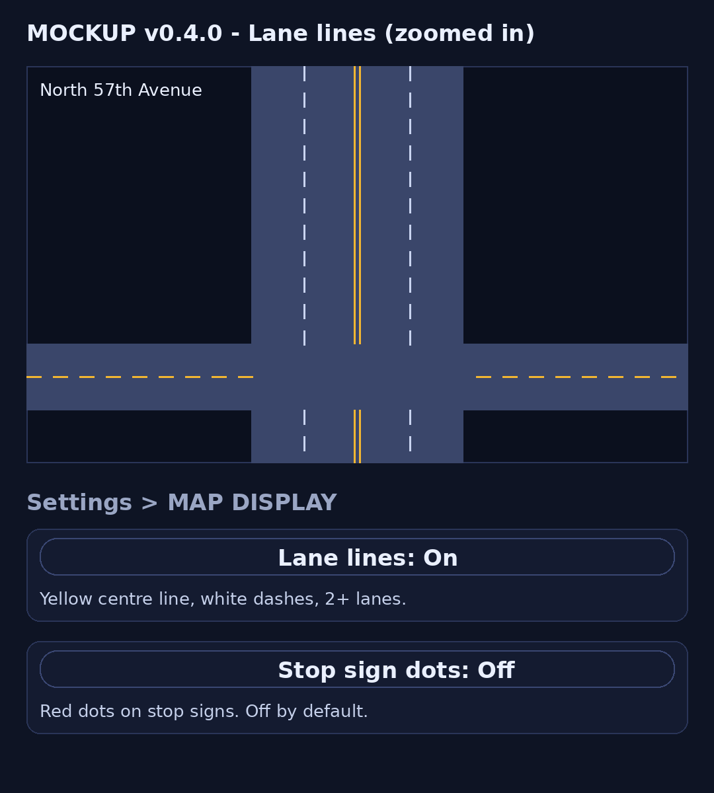

# Maps Coordinator v0.4.0 — Lane lines

- **Lane lines.** Zoom in and roads with 2+ lanes get a yellow double centre line (even lane counts) and white dashes between same-way lanes. They follow curves.
- **Stop sign dots are now off by default** (the red dots). Turn them on in Settings → MAP DISPLAY.
- Settings → MAP DISPLAY also has a Lane lines on/off switch.
- Lane counts come from OpenStreetMap, so roads with no lane tag show no lane lines. No re-import needed.
