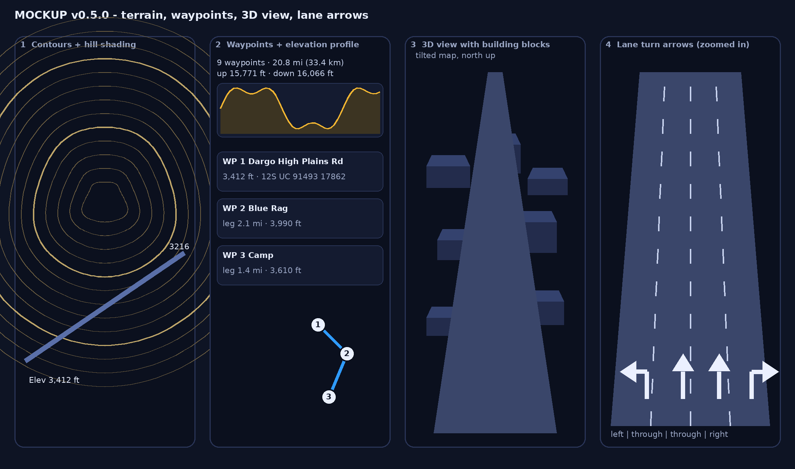

# Maps Coordinator v0.5.0 — Off-road terrain, waypoints, 3D view, lane arrows

**1. Terrain (needs elevation files)**
- Settings → ELEVATION → Import elevation file(s). Pick SRTM tiles named like `N33W112.hgt` or `N33W112.hgt.gz`. Many at once is fine.
- Contour lines in feet with labels, and hill shading. Both switch off in Settings → MAP DISPLAY.

**2. Waypoints and route**
- New ★ button. Add your GPS position or the map centre, name it, and the points join into a blue route line with numbered markers.
- Shows leg distances, elevation at each point, total distance, climb and descent, and an elevation profile.
- Straight legs between points. This is not turn-by-turn routing.

**3. 3D view**
- New 3D button tilts the map. Buildings stand up as blocks. Building heights need a **re-import** of your map; until then they use a default height.

**4. Lane turn arrows**
- Zoom in far on a road and arrows appear in each lane where OpenStreetMap has turn lane data. Needs a **re-import**. Coverage varies.

Everything stays offline.
