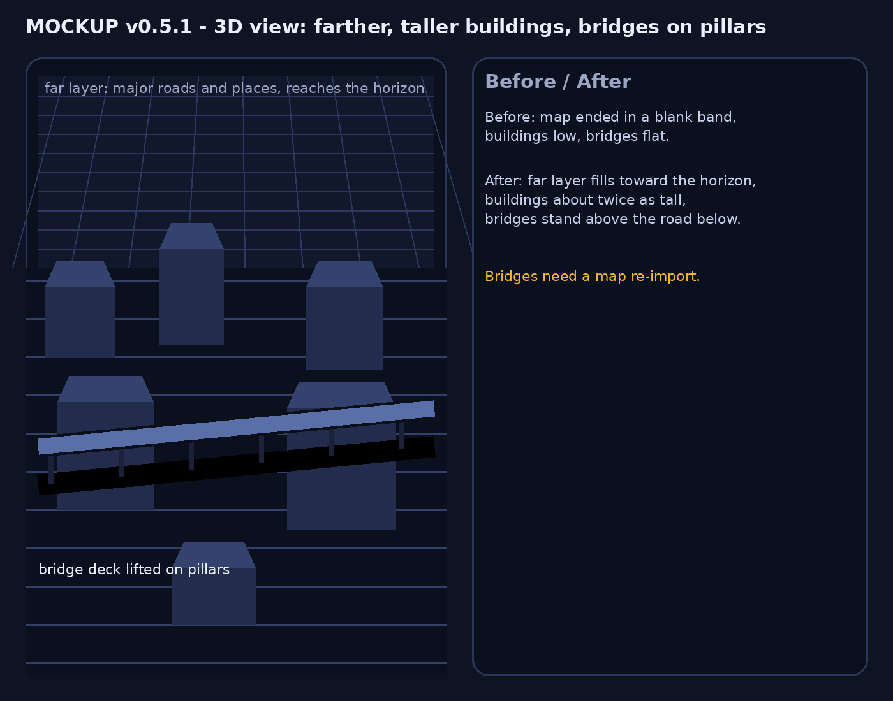

# Maps Coordinator v0.5.1 — 3D view fixes

- **3D view reaches farther.** A coarse layer behind the sharp map fills toward the horizon, so the blank band at the top is gone. It shows major roads and places far out.
- **Buildings are taller.** Drawn at about twice the old height. Buildings with no height in the map data now default to about two stories.
- **Bridges stand on pillars** in 3D view, with a shadow on the road below. This needs a **re-import** of your map, because the bridge tag is read at import.
- Everything stays offline.
